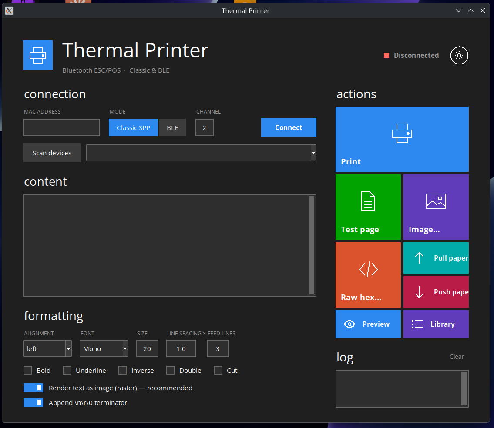

# YHK-E38B Thermal Printer GUI

A Windows 8 "Metro" style desktop app for the **YHK-E38B mini Bluetooth thermal printer**, written in Python and Tkinter for Linux.



Connect over Bluetooth, type some text (or pick an image), check a live preview and print, all from a clean, flat tile interface with dark and light themes.

> **Made for and tested on the YHK-E38B mini thermal printer (Bluetooth).** Other ESC/POS Bluetooth thermal printers that use 58 mm paper may work too, but they are untested.

<!-- Add a screenshot here once you have one:

-->

## Features

- **Metro UI**: coloured tiles, flat controls, thin pictograms, light typography, square checkboxes and on/off switches
- **Dark and light theme** with one-click switching
- **Two connection modes**: Classic Bluetooth (SPP / RFCOMM) and BLE
- **Device scan** with automatic RFCOMM channel detection
- **Text printing** with alignment, font (Mono / Sans / Serif), size, bold, underline, inverse, double size, line spacing, feed lines and optional paper cut
- **Raster text mode**: renders text as an image, so fonts and spacing print as you see them
- **Image printing** with a built-in editor: crop, fit to width, brightness, contrast, dithering and a print preview
- **Live text preview**: a paper-style window that updates as you type or change formatting
- **Templates and history**: save snippets together with their formatting and reprint them later; your last 50 prints are kept automatically
- **Paper feed controls** (pull / push paper) and a **raw hex** sender for ESC/POS commands
- **Feedback**: progress strip while sending, toast notifications instead of dialog boxes, and a "connection lost" indicator with a one-click reconnect

## Requirements

- Linux with BlueZ (`bluetoothctl`, and `sdptool` for channel detection)
- Python 3.8 or newer, built with Bluetooth socket support
- Tkinter
- [Pillow](https://pypi.org/project/pillow/) (text rendering, images, preview)
- [bleak](https://pypi.org/project/bleak/) (**optional**, only for BLE mode)

### Install

Debian / Ubuntu:

```bash
sudo apt install python3-tk bluez
```

Arch:

```bash
sudo pacman -S tk bluez bluez-utils
```

Then the Python packages:

```bash
pip install -r requirements.txt
```

## Usage

```bash
python3 bt_printer_metro.py
```

1. Turn the printer on and pair it with your computer (for example with `bluetoothctl` or your desktop's Bluetooth settings).
2. Click **Scan devices** and pick the printer, or type its MAC address.
3. Choose **Classic SPP** (default) or **BLE** and click **Connect**.
4. Type your text and click **Print**, or use **Test page**, **Image…**, **Preview** and **Library**.

## Where your data is stored

Templates and print history are saved locally in `~/.config/bt_printer/library.json`. Nothing is sent anywhere except to your printer.

## Troubleshooting

| Problem | Try this |
| --- | --- |
| "Python was not built with Bluetooth sockets" | Use your distribution's Python instead of a custom build, or switch to BLE mode. |
| Connection fails in Classic mode | Pair the printer first, and check the RFCOMM channel. Selecting the device in the list detects it automatically. |
| BLE mode says `bleak not installed` | `pip install bleak` |
| Text prints but looks wrong in native mode | Turn on **Render text as image (raster)**. |
| Nothing prints at the end of a job | Turn on **Append \n\r\0 terminator**, or increase **Feed lines**. |
| Headings look heavy instead of light | Install a light sans font such as Selawik or Open Sans Light. |

## Project files

| File | Purpose |
| --- | --- |
| `bt_printer_metro.py` | The whole application |
| `requirements.txt` | Python dependencies |

## License

MIT, see [LICENSE](LICENSE).